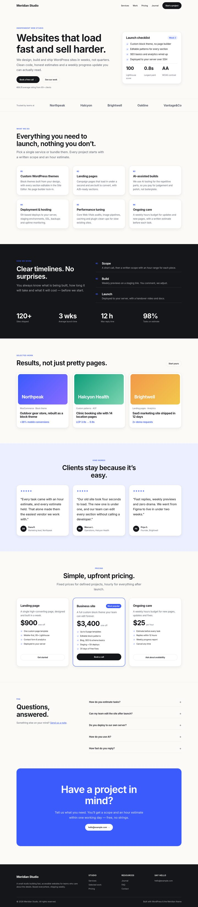
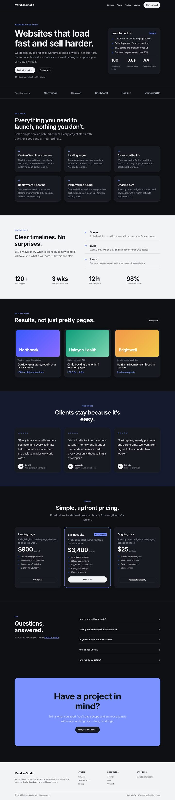
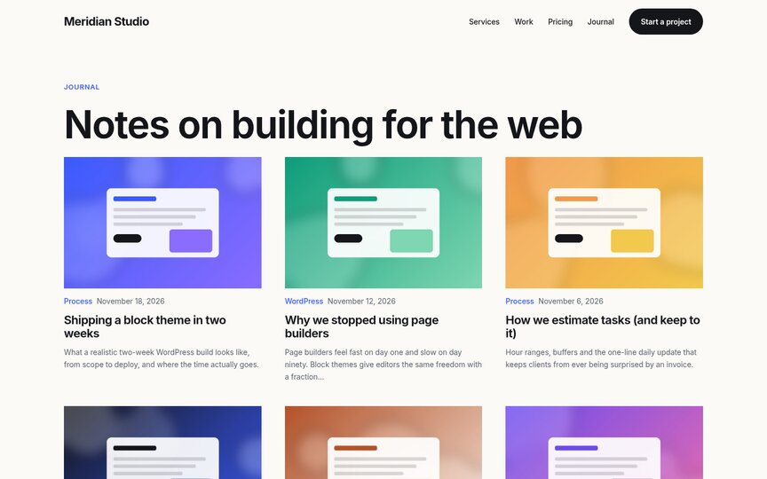
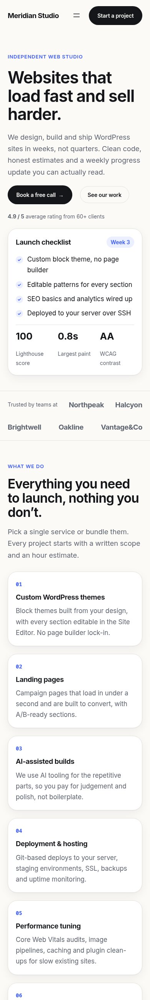

# Meridian — WordPress block theme

A clean, fast **full-site-editing block theme** for agencies, studios and small businesses.
Every section of the landing page is an editable block pattern, all design tokens live in `theme.json`, and there is **no page builder, no jQuery and no build step**.

**▶ [Live demo in WordPress Playground](https://playground.wordpress.net/?blueprint-url=https://raw.githubusercontent.com/kinglant/meridian-wp-theme/main/blueprint.json)** — boots a real WordPress in your browser with the theme and demo content installed (log in to the editor with `admin` / `password`).



## Features

- **Block theme (FSE):** 8 templates (`front-page`, `index`, `single`, `page`, `page-no-title`, `archive`, `search`, `404`) plus header and footer template parts. All are editable in *Appearance → Editor*.
- **10 block patterns**, available in the inserter under *Meridian*: hero, client strip, services grid, process + stats, case studies, testimonials, pricing, FAQ, CTA band and post grid.
- **3 style variations:** Default, **Midnight** (dark) and **Clay** (warm). Colours are mixed from the palette, so every section stays readable in each variation.
- **Design tokens in `theme.json`:** an 8-colour palette, fluid type scale, spacing scale, shadows, radii, and a self-hosted Inter variable font (no Google Fonts request).
- **Custom block styles:** *Card*, *Eyebrow*, *Checkmarks* list and *Button with arrow*.
- **Responsive and accessible:** CSS-grid layouts that collapse cleanly on phones, visible keyboard focus, `prefers-reduced-motion` support and a sticky translucent header.
- **Small PHP surface:** `functions.php` only enqueues one stylesheet and registers the pattern category, block styles and a reading-time shortcode.
- **Validated:** all 10 templates and parts (about 670 blocks in total) load in the Site Editor with zero invalid blocks.

| Midnight variation | Journal (post grid) | Mobile |
|---|---|---|
|  |  |  |

## Structure

```
meridian/
├── style.css            # theme header
├── theme.json           # palette, type, spacing, element & block styles
├── functions.php        # enqueue, pattern category, block styles, shortcode
├── assets/
│   ├── css/theme.css    # the few rules theme.json can't express
│   └── fonts/           # Inter variable (woff2, OFL)
├── templates/           # block templates (HTML)
├── parts/               # header.html, footer.html
├── patterns/            # PHP block patterns (translatable, escaped)
├── styles/              # midnight.json, clay.json
├── demo/                # demo content importer (used by the Playground blueprint only)
└── blueprint.json       # WordPress Playground live demo
```

## Install

1. Download this repo as a ZIP, or run `git clone https://github.com/kinglant/meridian-wp-theme.git meridian`.
2. Put the `meridian` folder in `wp-content/themes/`, or upload the ZIP under *Appearance → Themes → Add New → Upload*.
3. Activate the theme. The front page uses `front-page.html` automatically.
4. Optional: create a page called **Journal** and set it as the *Posts page* in *Settings → Reading* so the header link works.

## Local development

You don't need PHP or Docker. [WordPress Playground CLI](https://wordpress.github.io/wordpress-playground/developers/local-development/wp-playground-cli) runs WordPress in Node:

```bash
npx @wp-playground/cli server --login \
  --mount ./:/wordpress/wp-content/themes/meridian
```

Then open http://127.0.0.1:9400/wp-admin/themes.php and activate **Meridian**.

## Requirements

WordPress 6.6+ and PHP 7.4+.

## License

GPL-2.0-or-later. Inter font: SIL Open Font License 1.1.
